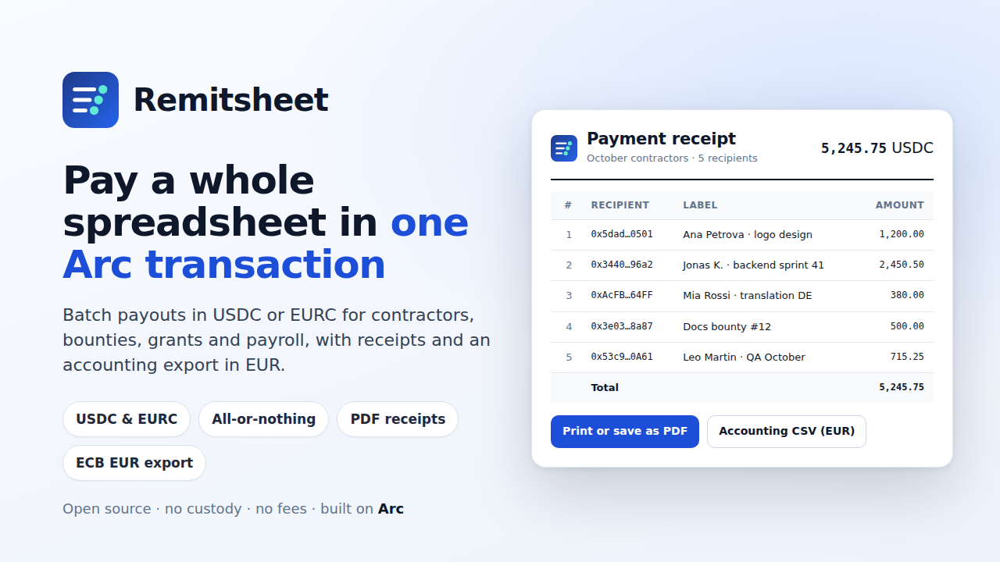

# Remitsheet

**Pay a whole spreadsheet in USDC or EURC with one Arc transaction, with receipts and EUR exports.**

Remitsheet is a small, open-source payout tool for teams that pay many people at once: contractors, bounty and grant winners, DAO contributors, payroll. Paste or upload `address,amount,label`, check every line, pay everyone in a single transaction on [Arc](https://docs.arc.io), and keep the paperwork: a printable receipt, a per-recipient payment advice, and an accounting CSV with EUR values at the ECB reference rate.

- **Live app:** https://aratass.github.io/remitsheet/ *(GitHub Pages, from the `docs/` folder)*
- **Contract (Arc mainnet):** [`0x015153204C9A1cBAefB959782490db74cD1a7DF5`](https://explorer.arc.io/address/0x015153204C9A1cBAefB959782490db74cD1a7DF5)
- **Example mainnet receipt:** [batch on Arc mainnet, 12 Oct 2026](https://aratass.github.io/remitsheet/?tx=0xca6f87f27b3ea0b37e131143608ad471ce9e7cadeb8bcc6e67d901b68060e8e1&chain=5042) (deployment transaction: [`0xd824…7268`](https://explorer.arc.io/tx/0xd8244a7e07fba766ec2611acf51c133c925d42ce8d23a2d48043a48013157268))
- **Walkthrough video (58 s, recorded on a local test chain):** [`submission/demo-local-chain.mp4`](submission/demo-local-chain.mp4)



## What it does

1. **Check the sheet.** Comma, semicolon or tab separated, header optional, labels optional. Every line is validated before anything can be sent: address format and EIP-55 checksum, zero address, duplicates, zero or negative amounts, more than 6 decimals, amounts split by an unquoted thousands separator, and addresses that are token or system contracts rather than people.
2. **Pay in one transaction.**
   - **USDC** is Arc's native currency, so a batch is a single transaction: `payNative` forwards each amount within the same call.
   - **EURC** goes through its ERC-20 contract: one approval of the exact total, then `payToken`.
   - Before the wallet is asked to sign, the batch is simulated. If a recipient would reject the payment (for example a contract without a receive function, or a restricted address), the failing line is highlighted and the Pay button stays disabled.
3. **Keep the paperwork.**
   - **Receipt page** (`?tx=0x…`): rebuilt from the transaction logs on every visit, so anyone with the link can check it. It shows the sender, time (UTC), reference, total, network fee and every line, and prints cleanly to an A4 PDF.
   - **Payment advice** (`?tx=0x…&to=0x…`): the same receipt, filtered to one recipient's line, to send to that person.
   - **Accounting CSV:** one row per payment plus one row for the network fee. Each row carries the EUR value at the ECB euro reference rate for the transaction date, with the rate, its date and its source in every row.

Labels never go on-chain. They stay in your browser (saved when you send) or can be re-attached to a receipt from your original CSV.

## Why Arc

- **Gas is USDC.** The payer needs nothing but the dollars being paid out. A 200-line batch costs about 0.05 to 0.15 USDC at Arc's 20 gwei minimum base fee (see [gas](#gas)).
- **Final on inclusion.** Arc blocks are final as they are included, so a receipt is a settled payment, not a pending one.
- **Dollars and euros.**
  - USDC is paid natively.
  - EURC is Circle's euro stablecoin, at `0xbEf5f6d51CB62b58e6A8f77868681825C6fe21c1` on Arc mainnet. It suits European teams, and the EUR accounting export follows naturally.
- **Arc specifics handled:**
  - Native USDC has 18 decimals, while the ERC-20 interface has 6. Sheet amounts are limited to 6 decimals and scaled ×10¹² for native payments, so both views agree.
  - Value transfers to blocklisted addresses or to `0x0` revert. They are caught by simulation and point at the line.
  - The network is added to the wallet with USDC as its 18-decimal native currency.

## How to use

1. Open the app and connect a browser wallet (Rabby or MetaMask; any EIP-6963 wallet is discovered). The app offers to add or switch to Arc (chain 5042).
2. Paste your sheet or upload a CSV, or click **Load example** to see the format. The example addresses are blocked on purpose.
3. Pick **USDC** or **EURC**, set a reference (up to 32 bytes, stored on-chain), check the fee estimate and press **Pay**.
4. Open the receipt: print or save it as PDF, download the accounting CSV, copy advice links for recipients.

Receipts for earlier batches: **Receipts** → paste the transaction hash. Batches sent from your browser are listed there.

## The contract

[`contracts/src/Remitsheet.sol`](contracts/src/Remitsheet.sol): 130 lines including comments (about 70 of code), Solidity 0.8.30, no dependencies.

| Function | What it does |
|---|---|
| `payNative(address[] to, uint256[] amounts, bytes32 ref)` payable | Pays native USDC. `msg.value` must equal the sum of `amounts`. |
| `payToken(address token, address[] to, uint256[] amounts, bytes32 ref)` | Pays an ERC-20 (EURC), moving tokens from the caller straight to each recipient with `transferFrom`. |

- **Events:** `Paid(ref, token, to, amount)` for every line, then `BatchPaid(ref, sender, token, total, count)`. A receipt can be rebuilt from the logs alone.
- **Errors** carry the failing index, for example `TransferFailed(index, to)`, `ZeroAddress(index)`, `ZeroAmount(index)`, `ValueMismatch(total, value)`, `LengthMismatch`, `EmptyBatch`, `InvalidToken`.
- **Deployment:** through the standard CREATE2 factory (`0x4e59b44847b379578588920cA78FbF26c0B4956C`, listed by Arc on mainnet and testnet) with salt `"Remitsheet v1"`.
  - The address is the same on every chain: `0x015153204C9A1cBAefB959782490db74cD1a7DF5`.
  - Anyone can deploy it, from the app's **Deploy** page, and deploying grants no control.
- **Verification on the explorer:** compiler input in [`contracts/verify/Remitsheet.standard-input.json`](contracts/verify/Remitsheet.standard-input.json). Settings: solc 0.8.30, optimizer 20,000 runs, EVM `prague`, no metadata hash. `npm run artifact` checks that this input reproduces the deployed bytecode exactly.

## Security notes

- **No custody.**
  - The contract has no owner, admin, fee, upgrade path or withdraw function, and it rejects plain transfers.
  - Native value is forwarded inside the call. Tokens never touch the contract.
- **All-or-nothing.** Any failed line reverts the whole batch. Nothing is sent, and only the network fee of a reverted transaction is spent. The app simulates first to avoid even that.
- **No one can spend your approval.** `payToken` always pulls from `msg.sender`, never from an address passed in. The app approves exactly the batch total, never an unlimited amount.
- **Reentrancy.**
  - Every call checks its own value and moves only the caller's own funds, so a reentering recipient or token can take nothing more than its line. Tests cover both cases, and a legitimate nested batch.
  - Recipient calls copy no return data, so a recipient cannot inflate the payer's gas with a huge return payload.
- **Verified receipts.** Receipts only trust events from code whose `keccak256` matches the Remitsheet runtime hash. The Deploy and Pay pages check the same hash before using the address.
- **Check your addresses.** Payments cannot be reversed. Checksums catch typos in mixed-case addresses, but nothing can detect a valid address of the wrong person.
- **Not audited.** The code is small and well tested, but it has not had a professional audit. Start with small amounts.

## Accounting export format

| Column | Meaning |
|---|---|
| `type` | `payment` or `network_fee` |
| `date_utc`, `time_utc` | Block time |
| `network`, `chain_id`, `tx_hash`, `block`, `explorer_url` | Where to verify |
| `batch_reference`, `sender`, `line`, `recipient`, `label` | Who and what |
| `asset`, `amount` | `USDC` or `EURC`; plain decimal, no separators |
| `eur_rate_date`, `usd_per_eur`, `eur_per_usd` | ECB reference rate actually used |
| `amount_eur` | EUR value, 2 decimals, rounded half up |
| `eur_rate_source` | Source of the rate and the valuation assumption |

- **USDC:** valued at 1 USD and converted at the ECB euro foreign exchange reference rate for the transaction date. On days without a rate (weekends, TARGET holidays, before about 16:00 CET), the latest earlier rate is used, and its date is recorded.
- **Rate sources:** loaded in the browser from [Frankfurter](https://frankfurter.dev), which republishes the ECB rates, with the ECB Data Portal as a fallback.
- **EURC:** valued at par.

The file is UTF-8 with a byte order mark and comma separated. An example is in [`submission/accounting-example.csv`](submission/accounting-example.csv).

## Gas

Full transaction gas (intrinsic + calldata + execution), measured with `npm run gas` on a local Anvil node. Fees are priced at Arc's documented 20 gwei minimum base fee. 1 gwei of native USDC is 10⁻⁹ USDC.

| Recipients | Recipient accounts | Native USDC: gas (per line) | Fee at 20 gwei | EURC (ERC-20): gas (per line) | Fee at 20 gwei |
|---:|---|---:|---:|---:|---:|
| 10 | new | 403,838 (40,383) | 0.0081 USDC | 323,239 (32,323) | 0.0065 USDC |
| 10 | already funded | 153,850 (15,385) | 0.0031 USDC | 152,239 (15,223) | 0.0030 USDC |
| 50 | new | 1,919,122 (38,382) | 0.0384 USDC | 1,476,267 (29,525) | 0.0295 USDC |
| 50 | already funded | 669,146 (13,382) | 0.0134 USDC | 621,267 (12,425) | 0.0124 USDC |
| 200 | new | 7,601,440 (38,007) | 0.1520 USDC | 5,800,293 (29,001) | 0.1160 USDC |
| 200 | already funded | 2,601,440 (13,007) | 0.0520 USDC | 2,380,437 (11,902) | 0.0476 USDC |

- **Deployment:** 519,594 gas, about 0.0104 USDC.
- **Batch cap:** 300 lines. The worst case, 300 new accounts, uses about 11.4M gas, under the 16.7M per-transaction cap of the Osaka hard fork that Arc targets.
- **Caveat:** standard Anvil does not emulate Arc's native-USDC precompile or blocklist, so real Arc gas may differ slightly. The app shows a live estimate before you confirm.

## Development

Requirements: Node 22+, [Foundry](https://getfoundry.sh) (forge and anvil).

```sh
git clone --recursive https://github.com/aratass/remitsheet && cd remitsheet
npm install
forge test -vv            # contract: unit, fuzz, reentrancy, failing-token and gas tests
npm run artifact          # embeds ABI + bytecode in the app, computes the CREATE2 address
npm run test:unit         # CSV validation, formatting and EUR conversion
npm run build             # bundles web/ into docs/
npm run test:e2e          # Playwright against a local Anvil node (see below)
npm run serve             # http://127.0.0.1:4173/?dev=1
```

The end-to-end test:

- **Setup:** starts Anvil, serves `docs/`, and injects an EIP-6963 test wallet backed by Anvil's dev account.
- **Flow:**
  1. Deploys Remitsheet from the Deploy page and checks that it lands on the predicted address.
  2. Checks validation of a bad sheet.
  3. Pays 5 recipients in USDC and checks every balance.
  4. Opens the receipt, prints it to PDF and exports the CSV, checking the EUR math.
  5. Opens a payment advice.
  6. Pays 3 recipients in EURC (approve + pay, exact allowance).
  7. Confirms that a recipient that rejects payments is caught before sending.
- **Output:** screenshots go to `submission/screenshots/`.

`?dev=1` (or localhost) enables a "Local test chain" (31337) next to Arc mainnet and testnet.

```
contracts/src/Remitsheet.sol      the contract
contracts/test/                   Foundry tests and mocks
web/src/                          app (TypeScript, viem, no framework)
docs/                             built site for GitHub Pages
e2e/run.mjs                       end-to-end test
scripts/                          artifact generator, gas report, images, static server
```

## License

[MIT](LICENSE)
